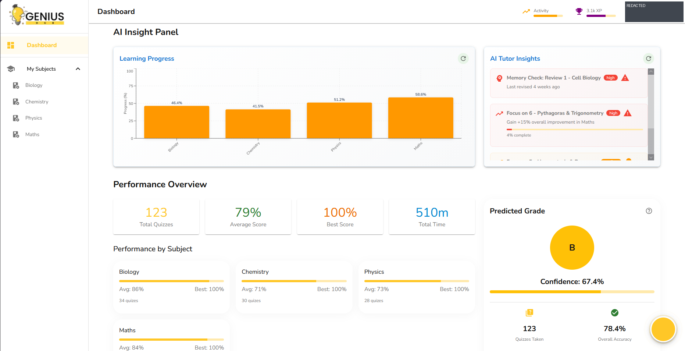
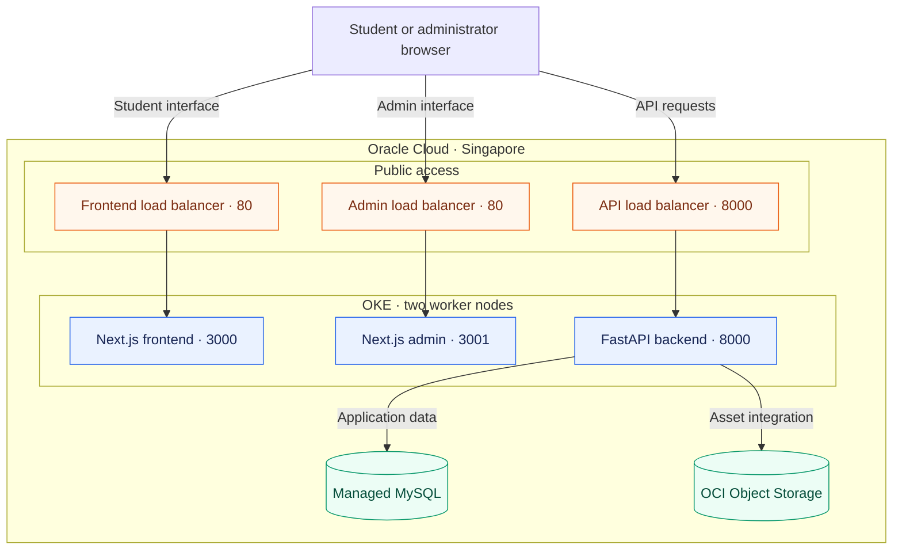
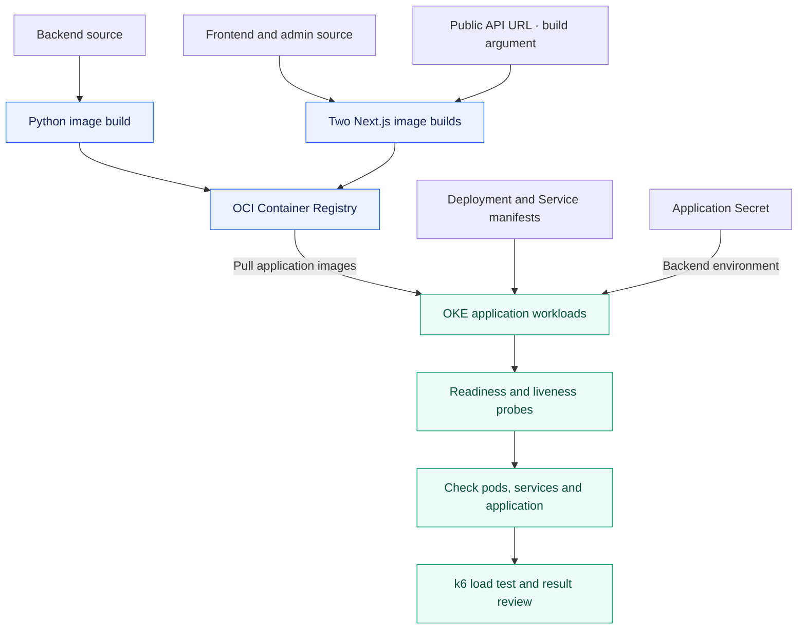
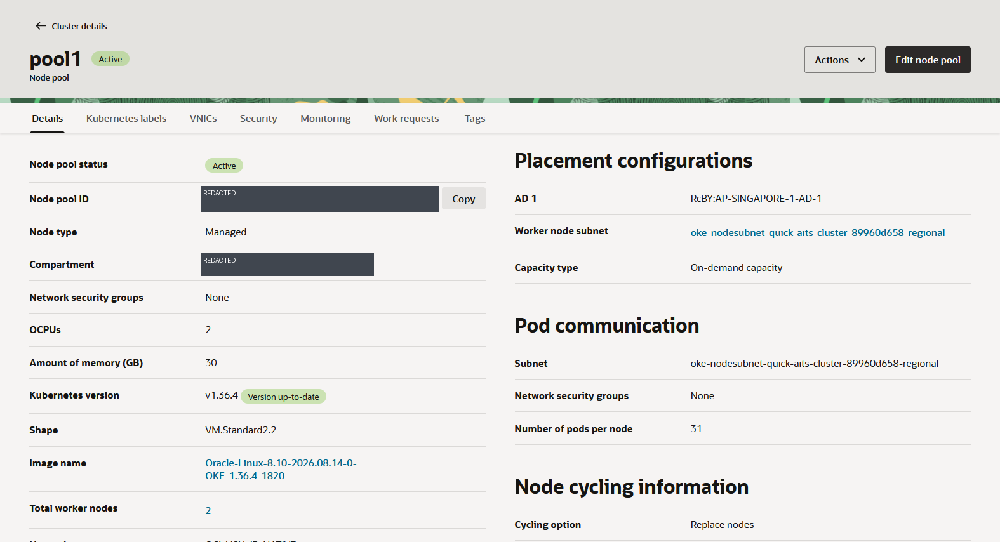
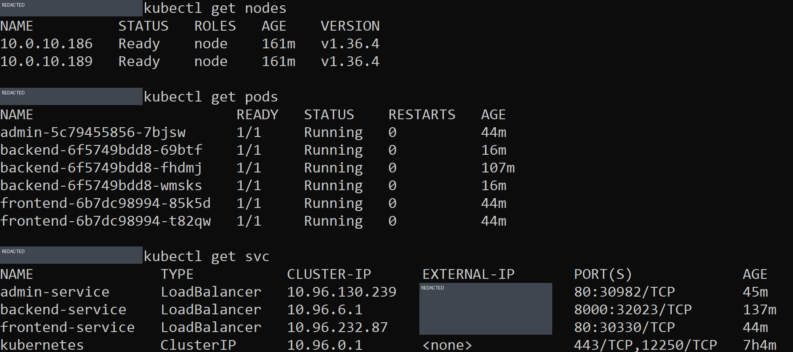
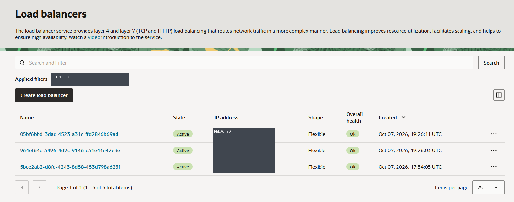
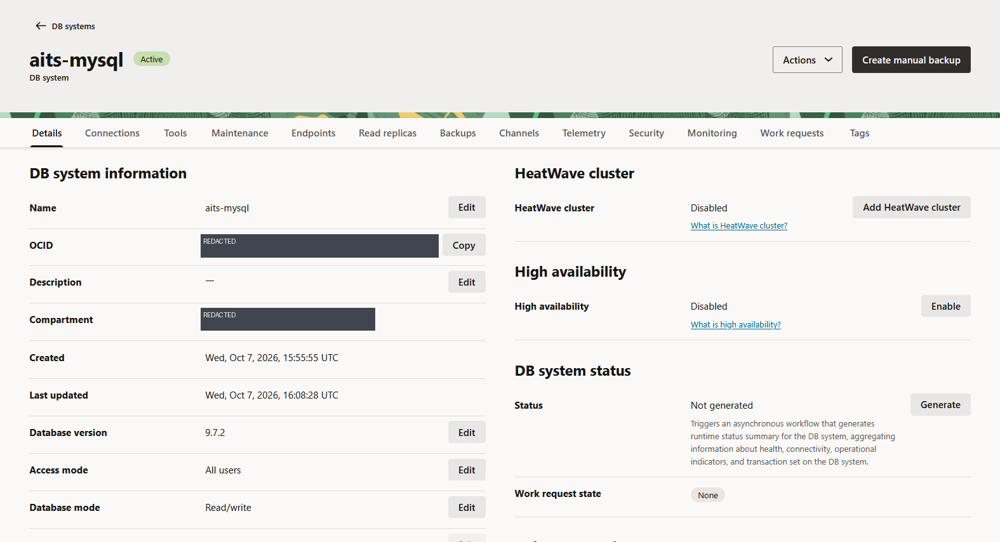
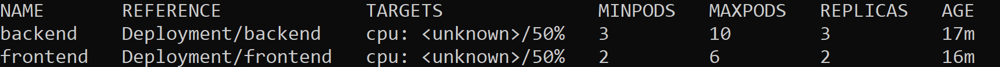
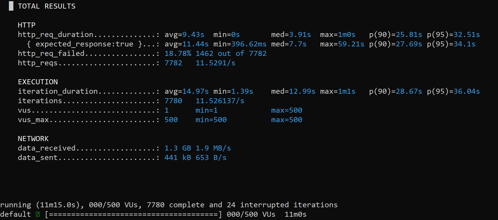

# AITS · Oracle Cloud Deployment

**Deploying a three-service educational application with Docker and Kubernetes on Oracle Cloud.**

AITS (Agentic Intelligent Tutoring System), presented in the application as **Genius Hub**, brings together a student interface, an admin panel and a backend API. I deployed these services on Oracle Kubernetes Engine (OKE), connected the application to managed MySQL and OCI Object Storage, and tested the deployment with k6.

This repository documents that work through deployment files, architecture diagrams and screenshots. The [AITS application case study](https://github.com/hameezG/AITS-case-study/) covers the wider project.

**Stack:** Oracle Cloud · Kubernetes · Docker · OCIR · Next.js · FastAPI · MySQL · k6

[Architecture](#architecture) · [Deployment evidence](#deployment-evidence) · [Load testing](#load-testing) · [Deployment guide](docs/deployment.md)

*The student dashboard captured from the deployed application. Account details have been redacted.*

## Project overview

The deployment separates the application into three containerized services:

| Service | Responsibility | Container port | Captured running replicas |
| --- | --- | --- | --- |
| Frontend | Next.js student interface | 3000 | 2 |
| Admin | Next.js administration panel | 3001 | 1 |
| Backend | FastAPI application API | 8000 | 3 |

My deployment work covered container builds, publishing images to OCIR, configuring Kubernetes workloads and public services, initializing the database, adding health probes and resource limits, configuring HPA policies, and recording load-test results.

The screenshots show a working deployment with **two Ready worker nodes, six Running application pods and three active load balancers**. They also capture areas needing further work, particularly unavailable HPA CPU metrics and elevated request failures during the load test.

## Architecture

### Application traffic

Each application service has its own OCI load balancer. The frontend and admin panel serve their interfaces to the browser, which sends API requests to the backend's public endpoint.

The asset connection represents the backend's storage integration; it does not imply that all asset downloads pass through the API. The captured bucket configuration was public.

### Build and deployment flow

The Dockerfiles build the services independently. Backend configuration is supplied through a Kubernetes Secret, while the browser-facing API URL is passed into the Next.js image builds.

This describes the manual deployment workflow. CI/CD automation is a future improvement.

## Deployment evidence

The following captures document the deployment at the time of testing. They are not a live status dashboard.

### 1. Worker infrastructure

The later node-pool capture shows two `VM.Standard2.2` workers, each configured with **2 OCPUs and 30 GB RAM**, in Singapore. The console reports Kubernetes `v1.36.4`.

### 2. Running workloads

The terminal output shows two Ready nodes, three backend pods, two frontend pods and one admin pod. All six application pods are Running and Ready in this capture.

### 3. Public access

Three flexible OCI load balancers expose the application services. All three show **Active** state and **OK** overall health in the capture. The supplied manifests set both the minimum and maximum bandwidth to **10 Mbps**.

### 4. Managed database

The application uses an OCI managed MySQL DB system. The supplied initialization pod creates the `genius_hub` database; the backend runs Alembic migrations before starting the API.

*Database high availability and the optional HeatWave cluster are disabled in this snapshot.*

## Workload configuration

The manifests include health probes, resource requests and limits for every application service.

| Service | Readiness / liveness path | CPU request / limit | Memory request / limit |
| --- | --- | --- | --- |
| Backend | `/api/v1/health` | 100m / 500m | 256Mi / 512Mi |
| Frontend | `/` | 100m / 500m | 256Mi / 512Mi |
| Admin | `/` | 250m / 500m | 256Mi / 512Mi |

The backend Deployment declares one initial replica. Its HPA policy sets a minimum of three, matching the three backend pods visible in the workload capture.

### Autoscaling configuration

| Deployment | Minimum replicas | Maximum replicas | CPU utilization target |
| --- | --- | --- | --- |
| Backend | 3 | 10 | 50% |
| Frontend | 2 | 6 | 50% |

**Status:** the policies are configured, but the screenshot shows CPU readings as `<unknown>`. Automatic scaling under load still needs verification. The captured HPA object names also differ from the supplied YAML; the [deployment guide](docs/deployment.md) explains that distinction.

## Load testing

The supplied k6 script repeatedly requests the frontend home page and pauses for one second between iterations. Its four stages ramp to **50 → 200 → 500 → 0 virtual users** over **11 minutes**. The five-minute stage ramps toward 200 users; it is not a sustained plateau.

| Metric | Recorded result |
| --- | --- |
| Peak virtual users | 500 |
| Total HTTP requests | 7,782 |
| Failed requests | 1,462 — 18.78% as reported by k6 |
| Average response time | 9.43 s |
| Median response time | 3.91 s |
| 95th-percentile response time | 32.51 s |
| Request rate | 11.5291 requests/s |

**What this showed:** the test exposed substantial latency and request failures as load increased. Reaching 500 virtual users does not establish reliable capacity for 500 concurrent users, and the available output does not identify the bottleneck.

This was a frontend HTTP test. It did not execute browser JavaScript, load all page assets or simulate authenticated learning sessions. See [testing and lessons](docs/testing-and-lessons.md) for the full scope and follow-up investigation.

## Using this repository

Start with the [deployment guide](docs/deployment.md) for prerequisites, image builds, configuration, deployment order and verification commands.

| Directory | Contents |
| --- | --- |
| `docker/` | Backend, frontend and admin Dockerfiles; Docker ignore example |
| `k8s/` | Application Deployments and Services, database initialization pod and HPA policies |
| `config/` | Application Secret example containing placeholders |
| `tests/` | k6 script with an explicit target URL |
| `screenshots/` | Seven named screenshots, all displayed in this README |
| `docs/` | Deployment guide, testing notes, screenshot provenance, source notes and sharing draft |

This repository contains the deployment configuration and documentation. Building the images requires the application source. Replace the registry and configuration placeholders before use, and keep real credentials outside version control.

The Dockerfiles and workload settings preserve the supplied deployment code. [Source notes](docs/source-notes.md) describe the publication changes and differences between configuration snapshots.

## Lessons and next steps

Three lessons stood out: browser-facing settings need to be correct at build time, deployed state must be checked alongside manifests, and performance results need both latency and failure metrics to be meaningful.

The next priorities are:

- Resolve HPA CPU metrics and demonstrate replica changes during a controlled test.
- Correlate application logs and infrastructure metrics to locate the performance limit.
- Add HTTPS, review admin access and bucket visibility, and test database recovery.
- Move migrations into a controlled one-off job and use immutable image versions.
- Add automated delivery, monitoring and authenticated application test scenarios.

These are planned improvements. The repository records the completed deployment and the evidence available from that work.

---

**Hameez Ahmad** · [GitHub](https://github.com/hameezG) · [AITS application case study](https://github.com/hameezG/AITS-case-study/)

